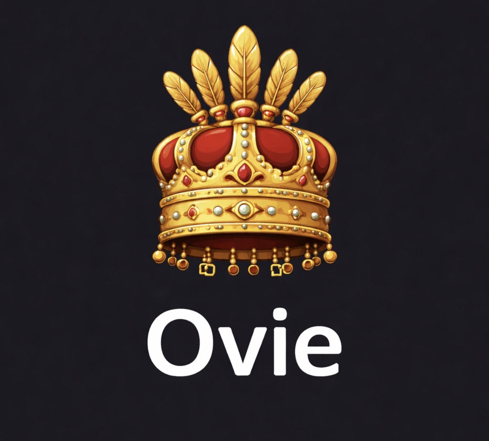

<div align="center">
  

  # Ovie — Systems Programming Made Accessible

  **v2.3.0 · Self-Hosted · Complete Module System · MIT License**

  Low-level control with high-level productivity.
  Natural syntax, complete standard library, Aproko analysis engine.

  [](https://github.com/couragereward/ovie)
  [](LICENSE)
  [](RELEASE_NOTES_v2.3.md)

  [Website](https://ovie.nashedy.io) · [Book](https://southwarridev.github.io/ovie/docs/book/index.html) · [Install](#installation) · [Docs](#documentation)
</div>

---

## What is Ovie?

Ovie is a low-level programming language with high-level features. Direct memory control, hardware access, predictable performance — wrapped in syntax that reads like what it means.

```ovie
// Declare constants with oya (immutable)
oya APP    = "Grade Calculator"
oya PASS   = 60

// Declare variables with mut (mutable)
mut score  = 0
mut passed = false

fn grade(s: Number) -> String {
    if s >= 90 { return "A" }
    if s >= 80 { return "B" }
    if s >= PASS { return "C" }
    return "F"
}

print("Enter score: ")
score  = string_to_number(string_trim(read_line()))
passed = score >= PASS

seeAm "Grade: " + grade(score)
seeAm "Passed: " + number_to_string(passed)
```

---

## The Two Core Keywords: oya and mut

```ovie
oya name = "Ovie"    // immutable — fixed, cannot be reassigned
mut count = 0        // mutable — can be updated
```

`oya` is Ovie's natural-language immutable keyword — use it for anything that should not change: constants, labels, config, error messages.

`mut` is for values that genuinely change: counters, state, user input results.

---

## What is New in v2.3

| Feature | Description |
|---------|-------------|
| `oya` keyword | Immutable variable declaration |
| Module System | Full `use`/`import`/`export`, dependency graph, circular detection |
| Aproko KB | AI/LLM-accessible type info and reasoning rules |
| Package Manager | `oviec init`, `oviec add`, `oviec install`, `ovie.lock` |
| 11 stdlib modules | core, math, io, fs, time, env, cli, log, testing, module, aproko |
| Self-hosted compiler | Stage 2.3 — compiles itself |

---

## Installation

**Windows (PowerShell as Admin):**
```powershell
iwr -useb https://raw.githubusercontent.com/southwarridev/ovie/main/easy-windows-install.ps1 | iex
```

**Linux:**
```bash
curl -sSL https://raw.githubusercontent.com/southwarridev/ovie/main/easy-linux-install.sh | bash
```

**macOS:**
```bash
curl -sSL https://raw.githubusercontent.com/southwarridev/ovie/main/easy-macos-install.sh | bash
```

**Build from source:**
```bash
git clone https://github.com/couragereward/ovie.git
cd ovie
cargo build --release --bin oviec
```

**Verify:**
```bash
oviec --version     # Ovie Compiler v2.3.0
oviec --self-check  # Full validation
```

---

## Quick Start

```bash
oviec run examples/hello.ov    # run hello world
oviec new my-project           # create new project
oviec run my-project/src/main.ov
```

---

## Language Features

### Variables

```ovie
oya name = "Ovie"         // immutable — use by default
mut counter = 0           // mutable — only when needed
counter = counter + 1
seeAm counter             // 1
```

### Functions

```ovie
fn add(a: Number, b: Number) -> Number {
    return a + b
}
seeAm add(10, 20)   // 30
```

### Control flow

```ovie
if score >= 90 {
    seeAm "A"
} else if score >= 60 {
    seeAm "Pass"
} else {
    seeAm "Fail"
}

for i in 0..5 { seeAm i }

mut n = 0
while n < 3 { n = n + 1 }
```

### User input

```ovie
print("Enter your name: ")
mut name = read_line()
seeAm "Hello, " + name
```

### Struct and enum

```ovie
struct Person { name: String, age: Number }
enum Status { Active, Inactive }

mut p = Person { name: "Amina", age: 28 }
seeAm p.name  // Amina
```

### Module system

```ovie
use std::math::{sqrt}
use std::io::{println}
export fn distance(x: Number, y: Number) -> Number {
    return sqrt(x * x + y * y)
}
```

---

## Standard Library

| Module | Description |
|--------|-------------|
| `std::core` | Result, Option, Vec, HashMap |
| `std::math` | sqrt, pow, abs, floor, ceil, min, max |
| `std::io` | println, print, read_line |
| `std::fs` | read_file, write_file, file_exists, make_dir |
| `std::time` | now, duration_ms, sleep_ms |
| `std::env` | get_var, args, hostname |
| `std::cli` | parse_args, flag_value |
| `std::log` | info, warn, error, debug |
| `std::testing` | assert_eq, assert_true, assert_false |
| `std::module` | load_module, resolve, kb_query |
| `std::aproko` | store_entry, get_type_info, export_json |

---

## Documentation

- [Getting Started](docs/getting-started.md)
- [Language Guide](docs/language-guide.md)
- [Beginner: The oya Keyword](docs/tutorials/beginners-oya-guide.md)
- [Build a Calculator (dev.to)](docs/tutorials/devto-calculator-tutorial.md)
- [The Ovie Book](docs/book/ovie-in-southern-kaduna/INDEX.md) — 12 chapters
- [Standard Library](docs/standard-library.md)
- [CLI Reference](docs/cli.md)
- [Aproko Guide](docs/aproko.md)

---

## Building and Contributing

```bash
git clone https://github.com/couragereward/ovie.git
cd ovie
cargo build --release --workspace
cargo test --package aproko --lib
```

See [CONTRIBUTING.md](CONTRIBUTING.md) for guidelines.

---

## Community

- GitHub: [github.com/southwarridev/ovie](https://github.com/southwarridev/ovie)
- GitLab: [gitlab.com/ovie1/ovie](https://gitlab.com/ovie1/ovie)
- Discord: [discord.gg/AuF4ubMyE](https://discord.gg/AuF4ubMyE)
- Website: [ovie.nashedy.io](https://ovie.nashedy.io)

---

## License

MIT — see [LICENSE](LICENSE).

*"Low-level control meets high-level productivity."*
